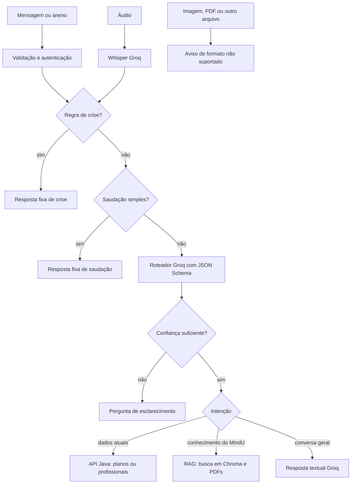

# Mila API

API FastAPI da assistente virtual do MindU. O modelo de resposta continua sendo `openai/gpt-oss-20b` pela Groq. O pipeline é controlado pela aplicação: segurança, saudação, classificação, RAG ou consulta ao Java. O Streamlit é apenas um laboratório local; o app e o site devem conversar com o backend Java.

## Fluxo



## Estrutura

| Caminho | Responsabilidade |
|---|---|
| `mila/main.py` | Cria a aplicação, inicializa o runtime e registra tratadores de erro. |
| `mila/config.py` | Única fonte de configuração (`Settings`). |
| `mila/schemas.py` | Contratos JSON e saída do roteador. |
| `mila/prompts.py` | Prompts e mensagens fixas. |
| `mila/security.py` | Validação da chave `X-Mila-API-Key` em tempo constante. |
| `mila/services/` | Segurança conversacional, roteamento, RAG, dados ao vivo, LLM e anexos. |
| `mila/knowledge/` | Extração, chunking, hash, indexação e busca Chroma. |
| `documentos/` | PDFs originais, que são a fonte de verdade e não são alterados pela aplicação. |
| `dados/chroma/` | Índice local, regenerável e ignorado pelo Git. |
| `tools/ui.py` | Laboratório Streamlit, fora da imagem de produção da API. |
| `tests/` | Testes offline, recuperação, perguntas douradas e teste opcional ao vivo. |

## Configuração

Copie `.env.example` para `.env` e preencha `GROQ_API_KEY`. O Compose local também precisa de `MINDU_ADMIN_SENHA` para iniciar o backend Java. Não adicione chaves ao Git nem à imagem Docker.

| Variável | Padrão | Uso |
|---|---|---|
| `APP_ENV` | `development` | Em `production`, exige `MILA_API_KEY`. |
| `GROQ_API_KEY` | obrigatório | Chave dos serviços Groq. |
| `GROQ_MODEL` | `openai/gpt-oss-20b` | Modelo de roteamento e respostas. |
| `GROQ_MODEL_ROUTER` | vazio | Modelo alternativo opcional para o roteador. |
| `GROQ_STT_MODEL` | `whisper-large-v3-turbo` | Modelo para transcrever áudio. |
| `LLM_TIMEOUT_S` | `30` | Timeout do Groq. |
| `LLM_MAX_RETRIES` | `2` | Retentativas do SDK. |
| `MILA_API_KEY` | vazio em desenvolvimento | Chave enviada no header `X-Mila-API-Key`. Obrigatória em produção. |
| `MILA_DEBUG` | `false` | Quando `true`, inclui diagnóstico local em `debug_info`. O Compose de laboratório ativa. |
| `MINDU_API_URL` | `http://localhost:8080` | Endereço do Java. Dentro do Compose local é `http://api:8080`. |
| `MINDU_API_TIMEOUT_S` | `8` | Timeout da API Java. |
| `EMBEDDING_MODEL` | `sentence-transformers/paraphrase-multilingual-MiniLM-L12-v2` | Embeddings locais do RAG. |
| `RAG_TOP_K` | `4` | Máximo de trechos candidatos por busca. |
| `RAG_MIN_RELEVANCE` | `0.40` | Relevância cosseno mínima por trecho; calibrar com o teste de recuperação. |
| `RAG_REWRITE_FOLLOWUPS` | `false` | Reescrita de continuação com uma chamada LLM adicional. |
| `ROUTER_MIN_CONFIDENCE` | `0.6` | Abaixo disso, a Mila pede esclarecimento. |
| `HISTORY_MAX_TURNS` | `8` | Turnos recentes usados pelo modelo. A Mila não persiste histórico. |
| `ATTACH_MAX_MB` | `10` | Tamanho máximo de anexo. |
| `SPECIALTIES` | `ansiedade,depressao,luto,estresse,relacionamento,sono,autismo,tdah` | Termos usados para filtrar tags públicas de profissionais. |
| `LOG_LEVEL` | `INFO` | Nível de log. Mensagens, histórico e transcrições não são logados. |

## Como executar

### Python local

No PowerShell, a partir desta pasta:

```powershell
py -3.12 -m venv .venv
.\.venv\Scripts\Activate.ps1
pip install -r requirements-dev.txt
if (-not (Test-Path .env)) { Copy-Item .env.example .env }
notepad .env
python -m mila.knowledge.ingest
python -m uvicorn mila.main:app --reload --port 8000
```

No `.env`, configure uma chave Groq válida. Se o Java estiver em execução no host, mantenha `MINDU_API_URL=http://localhost:8080`. A primeira preparação da base baixa o modelo de embeddings se ele ainda não estiver no cache.

### Laboratório com Docker Compose

Com Docker Desktop aberto, a partir da pasta `javaMindU`:

```powershell
docker compose -f docker-compose.local.yml --env-file ..\..\Projetos\Mila\.env up -d --build
```

O arquivo `.env` deve conter `GROQ_API_KEY` e `MINDU_ADMIN_SENHA`. A imagem pré-carrega o modelo de embeddings e indexa os PDFs durante o build. Acompanhe a inicialização com:

```powershell
docker compose -f docker-compose.local.yml --env-file ..\..\Projetos\Mila\.env logs -f mila
```

Abra `http://localhost:8501`. A lateral distingue a API ativa da API pronta; `/ready` fica pronto depois que as coleções são carregadas. O laboratório permite enviar texto, gravar e enviar mensagens de voz pelo microfone, além de anexar áudio, imagens, PDFs e outros arquivos para validar o comportamento. Para parar os serviços sem apagar o PostgreSQL local, use `docker compose -f docker-compose.local.yml down`.

### Imagem Docker da API

No diretório Mila, `docker build -t mila:local .` constrói a imagem padrão da API (estágio `api`). A imagem não inclui Streamlit, testes, `.env` nem chaves. Ela roda como usuário não-root e tem healthcheck em `/health`.

Para publicar no Docker Hub:

```powershell
docker build -t SEU_USUARIO/mila:latest .
docker push SEU_USUARIO/mila:latest
```

Configure `GROQ_API_KEY`, `APP_ENV=production` e `MILA_API_KEY` no serviço de hospedagem. O runtime aceita a porta da variável `PORT`.

### Compose do backend

Os arquivos `docker-compose.yml` e `docker-compose.local.yml` do `javaMindU` apontam para `../../Projetos/Mila` e constroem o estágio da API. Para um serviço Java dentro da mesma rede Docker, use `MINDU_API_URL=http://api:8080`; para o Java executado no host, use `http://host.docker.internal:8080`.

## Contrato HTTP

`POST /chat` mantém o contrato de texto atual; `transcription` é aditivo e será `null` para mensagens textuais.

```json
{
  "message": "Como funciona o cadastro?",
  "history": [{"role": "user", "content": "Oi"}]
}
```

Resposta:

```json
{
  "response": "...",
  "intent": "cadastro",
  "sources": ["02_cadastro_e_acesso.pdf"],
  "missing_info": false,
  "debug_info": {},
  "transcription": null
}
```

`intent` pode ser `saudacao`, `crise`, `sobre_mindu`, `cadastro`, `agendamento`, `empresa`, `dados_banco`, `normal`, `esclarecimento`, `arquivo_nao_suportado` ou `audio_ininteligivel`.

```bash
# Health de liveness, sem autenticação
curl http://localhost:8000/health

# Readiness: 200 quando as quatro coleções estão prontas
curl http://localhost:8000/ready

# Texto
curl -X POST http://localhost:8000/chat \
  -H 'Content-Type: application/json' \
  -H 'X-Mila-API-Key: SUA_CHAVE_LOCAL' \
  -d '{"message":"O que é o MindU e o que a Mila pode me ajudar a fazer?","history":[]}'

# Áudio; history é uma string JSON no multipart/form-data
curl -X POST http://localhost:8000/chat/audio \
  -H 'X-Mila-API-Key: SUA_CHAVE_LOCAL' \
  -F 'file=@pergunta.webm;type=audio/webm' \
  -F 'message=' \
  -F 'history=[]'

# PDF ou imagem: recebe uma resposta de produto arquivo_nao_suportado
curl -X POST http://localhost:8000/chat/audio \
  -H 'X-Mila-API-Key: SUA_CHAVE_LOCAL' \
  -F 'file=@manual.pdf;type=application/pdf' \
  -F 'history=[]'
```

Em desenvolvimento, `MILA_API_KEY` pode ficar vazia. Em produção, a aplicação não inicia sem a chave. `/health` e `/ready` não exigem autenticação. Erros técnicos retornam mensagens genéricas em português: `401` chave inválida, `413` anexo acima do limite, `422` entrada inválida e `502/503` indisponibilidade técnica.

## Áudio

Áudio passa pelo Whisper `whisper-large-v3-turbo`, com idioma `pt`, temperatura `0` e limite de 10 MB. A transcrição segue o mesmo pipeline de texto; portanto, uma frase de crise falada também passa pela regra de crise antes do roteador. O campo `transcription` devolve o texto reconhecido.

A Groq lista FLAC, MP3, M4A, MP4, MPEG, MPGA, OGG, WAV e WEBM para transcrição. O endpoint confere extensão e MIME. Gravação do navegador `webm/opus` deve ser enviada como `.webm`; use `.m4a` no Android. `.opus` isolado e `.3gp`/AMR não são aceitos. Consulte a [documentação de transcrição da Groq](https://console.groq.com/docs/speech-to-text) para limites atuais do provedor.

Imagem, PDF, vídeo e qualquer arquivo que não passe pela lista de áudio retornam HTTP 200, intent `arquivo_nao_suportado` e uma instrução para escrever a dúvida ou enviar áudio. A Mila não lê esses anexos.

## Testes e avaliação

```powershell
# Testes offline (padrão; sem Groq e sem baixar embeddings)
pytest

# Teste de recuperação com embeddings reais, sem chamar o LLM
pytest -m recovery -o addopts= tests/test_golden_recovery.py

# Teste ao vivo opcional; requer GROQ_API_KEY válida e internet
pytest -m live -o addopts= tests/test_live.py

# Qualidade estática
ruff check .
ruff format --check .
```

Os testes unitários usam fakes. O conjunto dourado em `tests/golden_questions.yaml` reaproveita as perguntas que existem nos PDFs, mas a ingestão remove a seção “Exemplos de perguntas para testar o RAG” antes de indexar. Ele também inclui perguntas fora do assunto para testar rejeição.

Para calibrar `RAG_MIN_RELEVANCE`, rode o teste `recovery` com o modelo real de embeddings. O valor deve ficar acima do maior score fora de escopo e abaixo do menor score das perguntas dentro do escopo. Ajuste o `.env` ou a configuração do Compose e repita a recuperação. A configuração parte de `0.40`; ela só deve ser reduzida se os testes mostrarem que perguntas válidas ficam abaixo do corte sem deixar as externas passarem.

Roteiro manual no Streamlit: cumprimento; pergunta sobre MindU; cadastro; agendamento; regra estática de plano; lista atual de profissionais; pergunta sem resposta nos PDFs; dados Java indisponíveis; crise por texto; crise em áudio; silêncio/áudio incompreensível; imagem; PDF; arquivo acima de 10 MB. Expanda os detalhes para ver rota, fontes, scores, filtros e trechos — apenas no laboratório com `MILA_DEBUG=true`.

## Adicionar ou atualizar conhecimento

Para adicionar uma intenção, coloque o PDF em `documentos/`, registre o nome do arquivo e o título em `mila/knowledge/ingest.py`, inclua a intenção no `RouteIntent` e no prompt do roteador, e acrescente perguntas com trechos esperados ao conjunto dourado. Se for uma nova rota ao vivo, altere o código só após confirmar o contrato do endpoint Java.

Para atualizar um PDF, substitua o arquivo mantendo o nome e reconstrua a imagem. O hash detecta a mudança de conteúdo e dos parâmetros do chunking, reindexando a coleção correspondente. Para reindexar localmente, execute `python -m mila.knowledge.ingest`.

O comando `python -m mila.knowledge.ingest --clean-legacy` remove coleções antigas das intenções que não seguem o esquema atual, preservando as coleções ativas `*_cosine_v2`. Use-o depois que as novas coleções estiverem disponíveis.

## Privacidade e logs

A Mila não grava mensagens, histórico, áudios ou transcrições em banco ou disco como armazenamento da aplicação. O áudio é mantido temporariamente durante a requisição e fechado ao final. O histórico que chega à Mila é processado apenas naquela chamada; no produto, o backend Java é responsável por persistência. O laboratório mantém mensagens somente na sessão Streamlit.

Logs contêm metadados operacionais, como intenção, tamanho, tempo, tipo de erro e status; não contêm texto da conversa, histórico nem transcrição. `debug_info` é `{}` por padrão e só mostra scores e trechos com `MILA_DEBUG=true`; mantenha essa opção ligada apenas no ambiente local controlado.

Texto, áudio e prompts são enviados à Groq para inferência. Os embeddings dos PDFs são gerados localmente. A API Java recebe somente consultas aos catálogos públicos e a Mila envia ao modelo campos públicos dos registros: nome, tipo, bio e tags de profissionais; nome, vagas e porte dos planos. A bio é tratada como dado, nunca como instrução.

## Problemas comuns

- **401 da Groq:** valide `GROQ_API_KEY` no `.env` e recrie o container para carregar a variável atualizada.
- **`/health` 200 e `/ready` 503:** a API está ativa, mas ainda está carregando as coleções ou encontrou um erro de inicialização; consulte os logs.
- **Consulta ao Java indisponível:** confirme `MINDU_API_URL`; use nome do serviço na rede Compose ou `host.docker.internal` para o host.
- **413 no anexo:** reduza o arquivo ou aumente `ATTACH_MAX_MB` dentro dos limites configurados.
- **Áudio incompreensível:** regrave com fala clara, pouco ruído e formato aceito; também é possível digitar a pergunta.
- **A imagem de produção não abre Streamlit:** rode o target `ui` pelo `docker-compose.local.yml`; o Streamlit fica fora da imagem da API.
- **Hospedagem pequena sem memória:** medir o consumo real; `torch` e Sentence Transformers podem exceder planos com RAM baixa. O modelo de embeddings é pré-baixado na imagem para evitar cold start de download.
